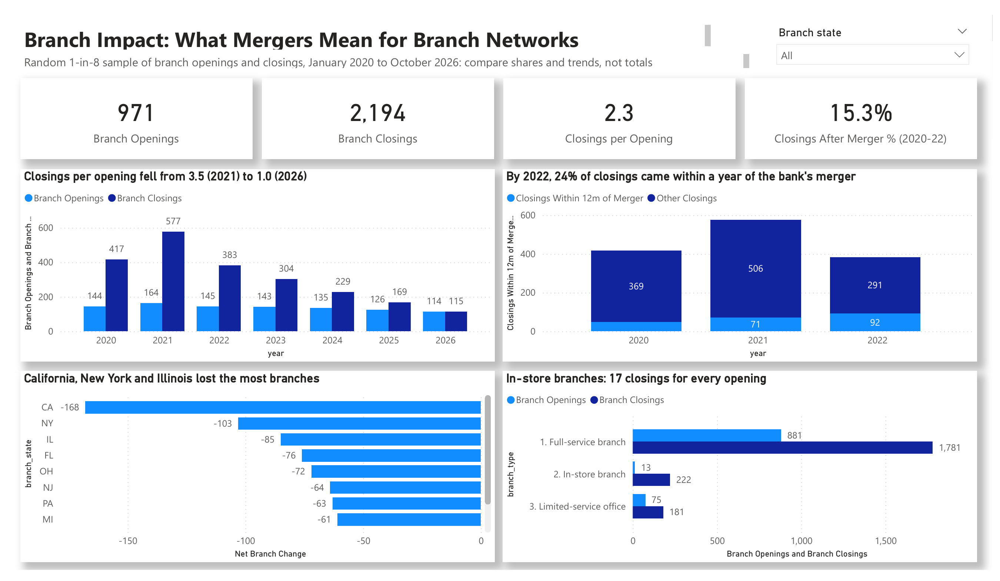
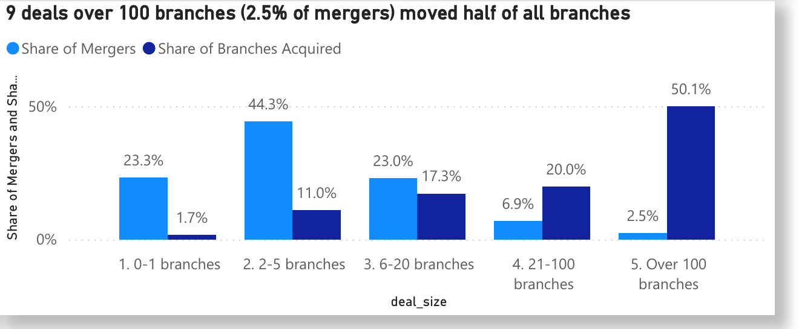

# US Bank Consolidation & Branch Impact: A Business Analysis

**Power BI Analysis Project · Public data · FDIC**

> **Summary:** Assessment of US banking consolidation trends, examining merger activity, branch network changes and potential customer impact.

[🌐 Project page](https://cjsmith-page.github.io/analysis/02-bank-consolidation/) · [📊 Dashboard (PDF)](dashboard/Bank_Consolidation_Dashboard.pdf) · [📄 Project brief](docs/Project_Brief.md) · [🧾 SQL](sql/Bankconsolidationanalysis.sql)

---

## At a Glance

| | |
|---|---|
| **Problem** | A merger is the largest change programme a bank undertakes. The integration team needed to know how fast banks are consolidating, and what that means for branches and customers. |
| **Finding** | 361 banks were absorbed while only 28 opened. Nine deals moved half of the 4,800 acquired branches, and buyers closed 81% more branches in the year after a merger. |
| **Recommendation** | A merger integration readiness checklist: reconcile before cutover, plan the first 12 months, protect at-risk customers and test the cutover. |

**Scope:** FDIC structure change history · Banks: Jan 2020 – Sep 2022 · Branches: one-in-eight sample

## The Business Problem

A merger is the largest change programme a bank goes through. Behind the scenes it is reconciliation and data migration at scale: accounts, positions and collateral must match across two systems before cutover, and branches are often closed afterwards.

The project brief defined four stakeholders and what each needs: the integration programme director (how large merger programmes are), the head of the branch network (when closures happen), reconciliation leads (what has to move) and Compliance (protecting customers through closure notices and complaints).

These needs became ten business questions and five KPIs: mergers, net change in banks, branches acquired, closings per opening and closings after a merger.

## The Dashboard for Stakeholders

Four pages: the change overview (KPIs and every type of change by year), consolidation (who is buying whom, by state, deal size and buyer), branch impact (openings against closings, with post-merger closings flagged) and the merger integration readiness checklist with KPIs and caveats.

Every chart title states its finding, and filters let a manager focus on one year or one state.

## Key Findings

1. **US banks are consolidating.** FDIC-insured banks fell by a net 357 in 33 months: 361 mergers, 4 failures and 20 voluntary closings, against only 28 new banks.  
   *Implication:* merger integration is a recurring, industry-wide change programme, not a one-off.
2. **Deals are fewer but larger.** The average merger moved 8.4 branches in 2020 and 19.2 in 2022. Nine deals, 2.5% of all mergers, moved half of the 4,800 branches that changed hands.  
   *Implication:* integration risk is concentrated in a small number of very large programmes.
3. **Closures follow mergers.** Buyers closed 81% more branches in the year after a merger than in the year before, while openings stayed flat.  
   *Implication:* the first 12 months after a merger are when customers are most affected.
4. **The pace of closures is easing.** Closings per opening fell from 3.5 in 2021 to 1.0 in 2026.  
   *Implication:* the network is stabilising overall, so post-merger closures stand out more clearly.
5. **In-store branches are hit hardest.** They close 17 times for every one that opens.  
   *Implication:* customers of in-store branches need the most support during a closure.

## Recommendations

1. **Reconcile before cutover.** Reconcile every account daily in the final weeks, matching records on stable IDs, never on names.  
   *Addresses finding 2 · **Measure:** unreconciled accounts at cutover.*
2. **Plan the first 12 months.** Make branch decisions and send customer notices early, because post-merger closures cluster in the first year.  
   *Addresses finding 3 · **Measure:** closures announced with full notice.*
3. **Protect the customers most at risk.** Give at least 90 days’ notice of a closure, with extra support for customers of in-store and rural branches.  
   *Addresses finding 5 · **Measure:** complaints linked to branch closures.*
4. **Test the cutover.** Test payments, cards and online banking with converted data, against clear go/no-go criteria.  
   *Reduces cutover risk · **Measure:** defects found before versus after go-live.*
5. **Measure the customer impact.** Compare complaints in the 90 days after a merger with the 90 days before.  
   *Closes the loop · **Measure:** change in complaint volume after a merger.*

## How the Analysis Was Done

The analysis was built in SQLite using DBeaver. A validation view first labels every row with a data-quality check. The script then builds a clean events table, a de-duplicated mergers table and a flag for branch closings within 12 months of the bank’s merger.

Nineteen queries follow, from what the extract contains and the pace of consolidation to who is buying whom and what happens to branches after a merger. Each query carries a comment stating the business question and the result.

## Understanding the Data

The FDIC download stops at exactly 10,000 rows, so before drawing conclusions I established what the file actually contained. Bank-level records, such as mergers and failures, are complete for everything processed up to October 2022, so bank-level results cover January 2020 to September 2022.

Branch records have random IDs, and the file holds every ID beginning 00 to 1f: one in eight of all possible IDs. That makes them a consistent one-in-eight sample in every year, so branch results are reported as shares and trends, not totals.

I also removed credit unions, de-duplicated mergers recorded from both sides, and joined every table on the bank’s FDIC certificate number, because bank names change but the certificate number does not.

## Repository Contents

| Folder | What it holds |
|---|---|
| `dashboard/` | The Power BI dashboard: PDF, template (`.pbit`) and screenshots |
| `sql/` | The SQL behind the numbers, each query commented with its business question and result |
| `data/` | The data and the cleaned tables the dashboard reads |
| `docs/` | The project brief and the detailed write-up |

**To open the dashboard:** open the `.pbit` file in Power BI Desktop and, when asked, point it to the files in `data/`.

**Data source:** Data: [FDIC BankFind Suite](https://banks.data.fdic.gov), structure change history · Tools: SQLite (DBeaver) · Power BI

---

### Business Analysis Experience

[Collateral Discrepancy Investigation](https://github.com/CJsmith-page/ba-experience-collateral-investigation) · [SLA Performance Analysis](https://github.com/CJsmith-page/ba-experience-sla-performance) · [Screening Platform Request Delivery](https://github.com/CJsmith-page/ba-experience-screening-delivery) · [Requirements and Prototype Delivery](https://github.com/CJsmith-page/ba-experience-requirements-delivery)

### More Power BI Projects

[Consumer Complaints & Response SLA](https://github.com/CJsmith-page/powerbi-consumer-complaints) · [Financial Crime Analytics](https://github.com/CJsmith-page/powerbi-financial-crime) · [Hotel Booking Cancellations](https://github.com/CJsmith-page/powerbi-hotel-cancellations) · [Online Retail Analysis](https://github.com/CJsmith-page/powerbi-online-retail)

**Cudjoe John Smith** · Business Analyst · [Portfolio](https://cjsmith-page.github.io) · [GitHub profile](https://github.com/CJsmith-page) · [LinkedIn](https://www.linkedin.com/in/c-john-smith/)
